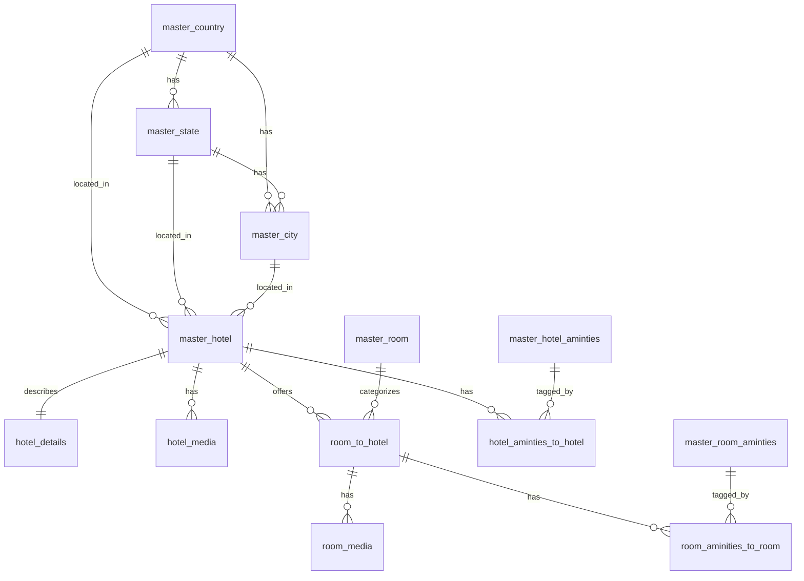

# Expedia Hotel Content — Standalone Database Schema

Standalone PostgreSQL schema for ingesting and storing hotel content pulled from
Expedia (Rapid Content / Property Content API). This is **independent of the
extranet's own contract/rate/booking database** — it only mirrors that project's
naming and modeling conventions so the two stay easy to reason about side by side.
No table here should be joined live against the extranet's schema; if a link is
ever needed, do it through an external mapping identifier, not a foreign key
across databases.

## 1. Scope

Content only — property/room master data, geography, media, amenities. No rates,
availability, or booking data (that belongs to a separate ingestion pipeline and
a separate schema).

Tables (as scoped by the project):

| Table | Purpose |
|---|---|
| `master_country` | Country reference data |
| `master_state` | State/province reference data |
| `master_city` | City reference data |
| `master_hotel` | Core hotel/property record |
| `hotel_details` | Extended descriptive/policy/statistics data (1:1 with hotel) |
| `hotel_media` | Hotel-level images (S3-hosted) |
| `master_room` | Room *type/category* taxonomy (Standard, Deluxe, Suite, ...) |
| `room_to_hotel` | Actual room instance as returned by Expedia for a given hotel |
| `room_media` | Room-level images (S3-hosted) |
| `master_hotel_aminties` | Hotel amenity catalog |
| `master_room_aminties` | Room amenity catalog |
| `hotel_aminties_to_hotel` | Hotel ↔ hotel-amenity pivot |
| `room_aminities_to_room` | Room ↔ room-amenity pivot |

> Table/column spelling `aminties` is kept intentionally to match the names
> already created in the target database.

## 2. Conventions

These mirror the extranet's Laravel/Postgres conventions where they made sense
for a standalone content warehouse, with a few deliberate simplifications:

- **Primary keys**: every table uses `id BIGSERIAL PRIMARY KEY`.
- **Naming**: `snake_case`, tables prefixed `master_*` for reference/catalog
  data, pivot tables named `{child}_to_{parent}` matching what's already been
  created.
- **Foreign keys**: named `{singular_referenced_entity}_id`, always explicitly
  indexed (Postgres does not auto-index FK columns), always with an explicit
  `ON DELETE` action — `CASCADE` for owned children (details/media/pivots),
  `RESTRICT`/`SET NULL` for shared reference data (geo).
- **Timestamps**: `created_at` / `updated_at` as `TIMESTAMPTZ NOT NULL DEFAULT now()`,
  kept current via a shared `set_updated_at()` trigger (Section 4). `TIMESTAMPTZ`
  is used everywhere (not the extranet's older naive `TIMESTAMP`) since this
  data is sourced from a global API and timezone-correctness matters.
- **Soft delete**: `deleted_at TIMESTAMPTZ NULL` on entity tables that can be
  independently retired (`master_hotel`, `room_to_hotel`, amenity catalogs,
  geo masters). Pivot and pure-media tables hard-delete (`ON DELETE CASCADE`
  from the parent is enough — there's no meaningful "soft-deleted photo").
- **Active/status flags**: simple reference/catalog tables use
  `is_active BOOLEAN NOT NULL DEFAULT TRUE`. The two primary entity tables
  (`master_hotel`, `room_to_hotel`) use a numeric `status SMALLINT` instead,
  since they need more than two states (see each table's comment for the
  enum values) — same pattern the extranet uses for `hotels_master`.
- **Dedupe keys**: no external supplier id is stored on these tables, so
  `master_hotel` enforces a case-insensitive unique index on `name` (ignoring
  soft-deleted rows) and `room_to_hotel` enforces uniqueness on
  `(hotel_id, room_name)` to prevent duplicate ingestion — same
  case-insensitive-name technique the extranet uses on `hotels_master`.
- **Media = URL only**: images/media are uploaded to S3 by the ingestion
  pipeline; the database only stores the resulting `media_url` (and the S3
  object key, for lifecycle/cleanup purposes) — never binary content.
- **Validation**: enforced in-database via `CHECK` constraints for bounded
  numeric ranges (ratings, coordinates, occupancy) and fixed vocabularies
  (`status`, `type`). Free-form categorical fields that come from Expedia
  with a large/evolving vocabulary (e.g. media `category`, room `view_type`)
  are intentionally left as indexed `VARCHAR`, not `CHECK`-constrained enums,
  so ingestion never breaks on a new Expedia value.
- **Money/geo datatypes**: `NUMERIC(10,7)` for latitude/longitude,
  `NUMERIC(8,2)` for room area, `CHAR(3)` for ISO currency codes, `CHAR(2)`/`CHAR(3)`
  for ISO country codes.

## 3. Entity relationship overview



`master_room` is a **taxonomy**, not per-hotel inventory: Expedia room ids are
unique per property, so there is no real cross-hotel "shared room" to model.
`master_room` instead normalizes room *category* ("Standard Room", "Deluxe
Suite", "Studio", ...) for filtering/reporting, and `room_to_hotel` holds the
actual room record as Expedia returns it for that specific hotel.

## 4. Shared trigger function

```sql
CREATE OR REPLACE FUNCTION set_updated_at()
RETURNS TRIGGER AS $$
BEGIN
    NEW.updated_at = now();
    RETURN NEW;
END;
$$ LANGUAGE plpgsql;
```

Every table below gets a `BEFORE UPDATE` trigger calling this function
(one `CREATE TRIGGER` per table, included at the end of each table's block).

## 5. Geography

### 5.1 `master_country`

```sql
CREATE TABLE master_country (
    id              BIGSERIAL PRIMARY KEY,
    name            VARCHAR(100) NOT NULL,
    iso2            CHAR(2) NOT NULL,
    iso3            CHAR(3) NOT NULL,
    phone_code      VARCHAR(10),
    currency_code   CHAR(3),
    region          VARCHAR(50),
    is_active       BOOLEAN NOT NULL DEFAULT TRUE,
    created_at      TIMESTAMPTZ NOT NULL DEFAULT now(),
    updated_at      TIMESTAMPTZ NOT NULL DEFAULT now(),

    CONSTRAINT master_country_iso2_unique UNIQUE (iso2),
    CONSTRAINT master_country_iso3_unique UNIQUE (iso3),
    CONSTRAINT master_country_iso2_format_chk CHECK (iso2 ~ '^[A-Z]{2}$'),
    CONSTRAINT master_country_iso3_format_chk CHECK (iso3 ~ '^[A-Z]{3}$')
);

CREATE INDEX master_country_name_idx ON master_country (name);
CREATE INDEX master_country_is_active_idx ON master_country (is_active);

CREATE TRIGGER trg_master_country_updated_at
    BEFORE UPDATE ON master_country
    FOR EACH ROW EXECUTE FUNCTION set_updated_at();
```

### 5.2 `master_state`

```sql
CREATE TABLE master_state (
    id              BIGSERIAL PRIMARY KEY,
    country_id      BIGINT NOT NULL REFERENCES master_country(id) ON DELETE RESTRICT,
    name            VARCHAR(150) NOT NULL,
    state_code      VARCHAR(10),
    is_active       BOOLEAN NOT NULL DEFAULT TRUE,
    created_at      TIMESTAMPTZ NOT NULL DEFAULT now(),
    updated_at      TIMESTAMPTZ NOT NULL DEFAULT now(),

    CONSTRAINT master_state_country_name_unique UNIQUE (country_id, name)
);

CREATE INDEX master_state_country_id_idx ON master_state (country_id);
CREATE INDEX master_state_name_idx ON master_state (name);
CREATE INDEX master_state_is_active_idx ON master_state (is_active);

CREATE TRIGGER trg_master_state_updated_at
    BEFORE UPDATE ON master_state
    FOR EACH ROW EXECUTE FUNCTION set_updated_at();
```

### 5.3 `master_city`

```sql
CREATE TABLE master_city (
    id              BIGSERIAL PRIMARY KEY,
    country_id      BIGINT NOT NULL REFERENCES master_country(id) ON DELETE RESTRICT,
    state_id        BIGINT REFERENCES master_state(id) ON DELETE SET NULL,
    name            VARCHAR(150) NOT NULL,
    latitude        NUMERIC(10,7),
    longitude       NUMERIC(10,7),
    timezone        VARCHAR(60),
    is_active       BOOLEAN NOT NULL DEFAULT TRUE,
    created_at      TIMESTAMPTZ NOT NULL DEFAULT now(),
    updated_at      TIMESTAMPTZ NOT NULL DEFAULT now(),

    CONSTRAINT master_city_country_state_name_unique UNIQUE (country_id, state_id, name),
    CONSTRAINT master_city_latitude_chk CHECK (latitude BETWEEN -90 AND 90),
    CONSTRAINT master_city_longitude_chk CHECK (longitude BETWEEN -180 AND 180)
);

CREATE INDEX master_city_country_id_idx ON master_city (country_id);
CREATE INDEX master_city_state_id_idx ON master_city (state_id);
CREATE INDEX master_city_name_idx ON master_city (name);
CREATE INDEX master_city_is_active_idx ON master_city (is_active);

CREATE TRIGGER trg_master_city_updated_at
    BEFORE UPDATE ON master_city
    FOR EACH ROW EXECUTE FUNCTION set_updated_at();
```

## 6. Hotel core

### 6.1 `master_hotel`

`status`: `0 = Inactive`, `1 = Active`, `2 = Draft` (awaiting first full sync).

```sql
CREATE TABLE master_hotel (
    id                      BIGSERIAL PRIMARY KEY,

    -- sync tracking
    last_synced_at         TIMESTAMPTZ,

    -- identity
    name                   VARCHAR(255) NOT NULL,
    normalized_name        VARCHAR(255),
    property_type          VARCHAR(60),
    chain_code             VARCHAR(60),
    chain_name             VARCHAR(150),
    brand_code             VARCHAR(60),
    brand_name             VARCHAR(150),
    rank                   INTEGER,
    multi_unit             BOOLEAN NOT NULL DEFAULT FALSE,

    -- ratings
    star_rating            NUMERIC(2,1),
    guest_rating           NUMERIC(3,1),
    review_count           INTEGER NOT NULL DEFAULT 0,

    -- geography
    country_id             BIGINT REFERENCES master_country(id) ON DELETE SET NULL,
    state_id               BIGINT REFERENCES master_state(id) ON DELETE SET NULL,
    city_id                BIGINT REFERENCES master_city(id) ON DELETE SET NULL,
    address_line1          VARCHAR(255),
    address_line2          VARCHAR(255),
    postal_code            VARCHAR(20),
    latitude               NUMERIC(10,7),
    longitude              NUMERIC(10,7),
    timezone               VARCHAR(60),

    -- contact
    phone                  VARCHAR(30),
    fax                    VARCHAR(30),
    email                  VARCHAR(150),
    website                VARCHAR(255),

    -- commercial
    currency_code          CHAR(3),
    status                 SMALLINT NOT NULL DEFAULT 2,

    created_at             TIMESTAMPTZ NOT NULL DEFAULT now(),
    updated_at             TIMESTAMPTZ NOT NULL DEFAULT now(),
    deleted_at             TIMESTAMPTZ,

    CONSTRAINT master_hotel_status_chk CHECK (status IN (0, 1, 2)),
    CONSTRAINT master_hotel_star_rating_chk CHECK (star_rating BETWEEN 0 AND 5),
    CONSTRAINT master_hotel_guest_rating_chk CHECK (guest_rating BETWEEN 0 AND 10),
    CONSTRAINT master_hotel_review_count_chk CHECK (review_count >= 0),
    CONSTRAINT master_hotel_latitude_chk CHECK (latitude BETWEEN -90 AND 90),
    CONSTRAINT master_hotel_longitude_chk CHECK (longitude BETWEEN -180 AND 180),
    CONSTRAINT master_hotel_email_format_chk CHECK (email IS NULL OR email ~ '^[^@\s]+@[^@\s]+\.[^@\s]+$')
);

CREATE INDEX master_hotel_name_idx ON master_hotel (name);
CREATE INDEX master_hotel_normalized_name_idx ON master_hotel USING gin (normalized_name gin_trgm_ops);
CREATE INDEX master_hotel_country_id_idx ON master_hotel (country_id);
CREATE INDEX master_hotel_state_id_idx ON master_hotel (state_id);
CREATE INDEX master_hotel_city_id_idx ON master_hotel (city_id);
CREATE INDEX master_hotel_status_idx ON master_hotel (status);
CREATE INDEX master_hotel_star_rating_idx ON master_hotel (star_rating);
CREATE INDEX master_hotel_chain_code_idx ON master_hotel (chain_code);
CREATE INDEX master_hotel_deleted_at_idx ON master_hotel (deleted_at);
CREATE UNIQUE INDEX master_hotel_name_ci_unique
    ON master_hotel (LOWER(TRIM(name))) WHERE deleted_at IS NULL;

CREATE TRIGGER trg_master_hotel_updated_at
    BEFORE UPDATE ON master_hotel
    FOR EACH ROW EXECUTE FUNCTION set_updated_at();
```

> `master_hotel_normalized_name_idx` uses the trigram (`pg_trgm`) extension for
> fuzzy name search/dedup — same technique the extranet uses on `hotels_master`.
> Enable it once per database: `CREATE EXTENSION IF NOT EXISTS pg_trgm;`

### 6.2 `hotel_details` (1:1 with `master_hotel`)

Everything descriptive/policy/statistical that would otherwise bloat the core
row lives here — same "lean core + themed satellite" pattern the extranet uses
for `hotel_contact_details` / `hotel_notes` / `hotel_policies`.

```sql
CREATE TABLE hotel_details (
    id                      BIGSERIAL PRIMARY KEY,
    hotel_id                BIGINT NOT NULL REFERENCES master_hotel(id) ON DELETE CASCADE,

    -- descriptions
    headline                VARCHAR(255),
    short_description       TEXT,
    full_description        TEXT,
    amenities_summary       TEXT,

    -- check-in / check-out
    check_in_time           VARCHAR(5),
    check_out_time          VARCHAR(5),
    check_in_instructions   TEXT,
    special_instructions    TEXT,
    min_checkin_age         SMALLINT,

    -- policies
    pet_policy              VARCHAR(255),
    smoking_policy          VARCHAR(60),
    children_policy         TEXT,
    extra_bed_policy        TEXT,
    mandatory_fees          TEXT,
    optional_fees           TEXT,
    know_before_you_go      TEXT,

    -- statistics
    total_rooms             INTEGER,
    total_floors             INTEGER,
    year_built               SMALLINT,
    year_renovated           SMALLINT,

    -- flexible/semi-structured extras straight from Expedia's payload
    spoken_languages        JSONB,
    payment_types_accepted  JSONB,
    themes                  JSONB,
    attributes              JSONB,

    created_at              TIMESTAMPTZ NOT NULL DEFAULT now(),
    updated_at              TIMESTAMPTZ NOT NULL DEFAULT now(),

    CONSTRAINT hotel_details_hotel_id_unique UNIQUE (hotel_id),
    CONSTRAINT hotel_details_total_rooms_chk CHECK (total_rooms IS NULL OR total_rooms >= 0),
    CONSTRAINT hotel_details_min_checkin_age_chk CHECK (min_checkin_age IS NULL OR min_checkin_age >= 0)
);

CREATE TRIGGER trg_hotel_details_updated_at
    BEFORE UPDATE ON hotel_details
    FOR EACH ROW EXECUTE FUNCTION set_updated_at();
```

### 6.3 `hotel_media`

```sql
CREATE TABLE hotel_media (
    id              BIGSERIAL PRIMARY KEY,
    hotel_id        BIGINT NOT NULL REFERENCES master_hotel(id) ON DELETE CASCADE,
    media_url       VARCHAR(1024) NOT NULL,
    s3_key          VARCHAR(1024),
    source_url      TEXT,
    category        VARCHAR(50) NOT NULL DEFAULT 'Other',
    caption         VARCHAR(255),
    width           INTEGER,
    height          INTEGER,
    is_primary      BOOLEAN NOT NULL DEFAULT FALSE,
    sort_order      INTEGER NOT NULL DEFAULT 0,
    created_at      TIMESTAMPTZ NOT NULL DEFAULT now(),
    updated_at      TIMESTAMPTZ NOT NULL DEFAULT now(),

    CONSTRAINT hotel_media_width_chk CHECK (width IS NULL OR width > 0),
    CONSTRAINT hotel_media_height_chk CHECK (height IS NULL OR height > 0)
);

CREATE INDEX hotel_media_hotel_id_idx ON hotel_media (hotel_id);
CREATE INDEX hotel_media_hotel_sort_idx ON hotel_media (hotel_id, sort_order);
CREATE INDEX hotel_media_category_idx ON hotel_media (category);
CREATE UNIQUE INDEX hotel_media_one_primary_per_hotel_uq
    ON hotel_media (hotel_id) WHERE is_primary = TRUE;

CREATE TRIGGER trg_hotel_media_updated_at
    BEFORE UPDATE ON hotel_media
    FOR EACH ROW EXECUTE FUNCTION set_updated_at();
```

`category` typical values (not `CHECK`-constrained — Expedia's list is long
and grows): `Exterior`, `Lobby`, `Room`, `Bathroom`, `Pool`, `Restaurant`,
`Bar`, `Spa`, `Gym`, `Meeting Room`, `Golf`, `Other`.

## 7. Rooms

### 7.1 `master_room` (room type taxonomy)

```sql
CREATE TABLE master_room (
    id              BIGSERIAL PRIMARY KEY,
    name            VARCHAR(150) NOT NULL,
    code            VARCHAR(50),
    description     VARCHAR(255),
    is_active       BOOLEAN NOT NULL DEFAULT TRUE,
    created_at      TIMESTAMPTZ NOT NULL DEFAULT now(),
    updated_at      TIMESTAMPTZ NOT NULL DEFAULT now(),

    CONSTRAINT master_room_name_unique UNIQUE (name),
    CONSTRAINT master_room_code_unique UNIQUE (code)
);

CREATE INDEX master_room_is_active_idx ON master_room (is_active);

CREATE TRIGGER trg_master_room_updated_at
    BEFORE UPDATE ON master_room
    FOR EACH ROW EXECUTE FUNCTION set_updated_at();
```

### 7.2 `room_to_hotel` (actual room instance per hotel, as returned by Expedia)

`status`: `0 = Inactive`, `1 = Active`.

```sql
CREATE TABLE room_to_hotel (
    id                  BIGSERIAL PRIMARY KEY,

    hotel_id            BIGINT NOT NULL REFERENCES master_hotel(id) ON DELETE CASCADE,
    room_id             BIGINT REFERENCES master_room(id) ON DELETE SET NULL,

    -- identity
    room_name           VARCHAR(255) NOT NULL,
    description         TEXT,

    -- occupancy
    max_occupancy       SMALLINT,
    max_adults          SMALLINT,
    max_children        SMALLINT,
    min_adults          SMALLINT NOT NULL DEFAULT 1,

    -- layout
    num_bedrooms        SMALLINT,
    num_bathrooms       SMALLINT,
    bed_type            VARCHAR(100),
    bed_count           SMALLINT,
    bed_groups          JSONB,
    area_sqm            NUMERIC(8,2),
    area_sqft           NUMERIC(8,2),
    view_type           VARCHAR(100),
    smoking_allowed     BOOLEAN,

    status              SMALLINT NOT NULL DEFAULT 1,

    created_at          TIMESTAMPTZ NOT NULL DEFAULT now(),
    updated_at          TIMESTAMPTZ NOT NULL DEFAULT now(),
    deleted_at          TIMESTAMPTZ,

    CONSTRAINT room_to_hotel_status_chk CHECK (status IN (0, 1)),
    CONSTRAINT room_to_hotel_max_occupancy_chk CHECK (max_occupancy IS NULL OR max_occupancy > 0),
    CONSTRAINT room_to_hotel_max_adults_chk CHECK (max_adults IS NULL OR max_adults > 0),
    CONSTRAINT room_to_hotel_max_children_chk CHECK (max_children IS NULL OR max_children >= 0),
    CONSTRAINT room_to_hotel_area_sqm_chk CHECK (area_sqm IS NULL OR area_sqm > 0),
    CONSTRAINT room_to_hotel_area_sqft_chk CHECK (area_sqft IS NULL OR area_sqft > 0)
);

CREATE INDEX room_to_hotel_hotel_id_idx ON room_to_hotel (hotel_id);
CREATE INDEX room_to_hotel_room_id_idx ON room_to_hotel (room_id);
CREATE INDEX room_to_hotel_status_idx ON room_to_hotel (status);
CREATE INDEX room_to_hotel_deleted_at_idx ON room_to_hotel (deleted_at);
CREATE UNIQUE INDEX room_to_hotel_hotel_room_name_ci_unique
    ON room_to_hotel (hotel_id, LOWER(TRIM(room_name))) WHERE deleted_at IS NULL;

CREATE TRIGGER trg_room_to_hotel_updated_at
    BEFORE UPDATE ON room_to_hotel
    FOR EACH ROW EXECUTE FUNCTION set_updated_at();
```

### 7.3 `room_media`

```sql
CREATE TABLE room_media (
    id                  BIGSERIAL PRIMARY KEY,
    room_to_hotel_id    BIGINT NOT NULL REFERENCES room_to_hotel(id) ON DELETE CASCADE,
    media_url           VARCHAR(1024) NOT NULL,
    s3_key              VARCHAR(1024),
    source_url          TEXT,
    caption             VARCHAR(255),
    width               INTEGER,
    height              INTEGER,
    is_primary          BOOLEAN NOT NULL DEFAULT FALSE,
    sort_order          INTEGER NOT NULL DEFAULT 0,
    created_at          TIMESTAMPTZ NOT NULL DEFAULT now(),
    updated_at          TIMESTAMPTZ NOT NULL DEFAULT now(),

    CONSTRAINT room_media_width_chk CHECK (width IS NULL OR width > 0),
    CONSTRAINT room_media_height_chk CHECK (height IS NULL OR height > 0)
);

CREATE INDEX room_media_room_to_hotel_id_idx ON room_media (room_to_hotel_id);
CREATE INDEX room_media_room_sort_idx ON room_media (room_to_hotel_id, sort_order);
CREATE UNIQUE INDEX room_media_one_primary_per_room_uq
    ON room_media (room_to_hotel_id) WHERE is_primary = TRUE;

CREATE TRIGGER trg_room_media_updated_at
    BEFORE UPDATE ON room_media
    FOR EACH ROW EXECUTE FUNCTION set_updated_at();
```

## 8. Amenities

### 8.1 `master_hotel_aminties`

```sql
CREATE TABLE master_hotel_aminties (
    id              BIGSERIAL PRIMARY KEY,
    name            VARCHAR(150) NOT NULL,
    code            VARCHAR(60),
    category        VARCHAR(80),
    icon            VARCHAR(255),
    type            VARCHAR(20) NOT NULL DEFAULT 'free',
    description     VARCHAR(255),
    is_active       BOOLEAN NOT NULL DEFAULT TRUE,
    created_at      TIMESTAMPTZ NOT NULL DEFAULT now(),
    updated_at      TIMESTAMPTZ NOT NULL DEFAULT now(),
    deleted_at      TIMESTAMPTZ,

    CONSTRAINT master_hotel_aminties_name_unique UNIQUE (name),
    CONSTRAINT master_hotel_aminties_code_unique UNIQUE (code),
    CONSTRAINT master_hotel_aminties_type_chk CHECK (type IN ('free', 'paid'))
);

CREATE INDEX master_hotel_aminties_category_idx ON master_hotel_aminties (category);
CREATE INDEX master_hotel_aminties_is_active_idx ON master_hotel_aminties (is_active);

CREATE TRIGGER trg_master_hotel_aminties_updated_at
    BEFORE UPDATE ON master_hotel_aminties
    FOR EACH ROW EXECUTE FUNCTION set_updated_at();
```

### 8.2 `master_room_aminties`

```sql
CREATE TABLE master_room_aminties (
    id              BIGSERIAL PRIMARY KEY,
    name            VARCHAR(150) NOT NULL,
    code            VARCHAR(60),
    category        VARCHAR(80),
    icon            VARCHAR(255),
    description     VARCHAR(255),
    is_active       BOOLEAN NOT NULL DEFAULT TRUE,
    created_at      TIMESTAMPTZ NOT NULL DEFAULT now(),
    updated_at      TIMESTAMPTZ NOT NULL DEFAULT now(),
    deleted_at      TIMESTAMPTZ,

    CONSTRAINT master_room_aminties_name_unique UNIQUE (name),
    CONSTRAINT master_room_aminties_code_unique UNIQUE (code)
);

CREATE INDEX master_room_aminties_category_idx ON master_room_aminties (category);
CREATE INDEX master_room_aminties_is_active_idx ON master_room_aminties (is_active);

CREATE TRIGGER trg_master_room_aminties_updated_at
    BEFORE UPDATE ON master_room_aminties
    FOR EACH ROW EXECUTE FUNCTION set_updated_at();
```

### 8.3 `hotel_aminties_to_hotel` (pivot)

```sql
CREATE TABLE hotel_aminties_to_hotel (
    id                  BIGSERIAL PRIMARY KEY,
    hotel_id            BIGINT NOT NULL REFERENCES master_hotel(id) ON DELETE CASCADE,
    hotel_amenity_id    BIGINT NOT NULL REFERENCES master_hotel_aminties(id) ON DELETE CASCADE,
    created_at          TIMESTAMPTZ NOT NULL DEFAULT now(),

    CONSTRAINT hotel_aminties_to_hotel_unique UNIQUE (hotel_id, hotel_amenity_id)
);

CREATE INDEX hotel_aminties_to_hotel_hotel_id_idx ON hotel_aminties_to_hotel (hotel_id);
CREATE INDEX hotel_aminties_to_hotel_amenity_id_idx ON hotel_aminties_to_hotel (hotel_amenity_id);
```

### 8.4 `room_aminities_to_room` (pivot)

Maps to `room_to_hotel` (the actual room instance), not `master_room` (the
taxonomy) — amenities like "sea view" or "bathtub" are specific to the real
room Expedia returned, not to the abstract category.

```sql
CREATE TABLE room_aminities_to_room (
    id                  BIGSERIAL PRIMARY KEY,
    room_to_hotel_id    BIGINT NOT NULL REFERENCES room_to_hotel(id) ON DELETE CASCADE,
    room_amenity_id     BIGINT NOT NULL REFERENCES master_room_aminties(id) ON DELETE CASCADE,
    created_at          TIMESTAMPTZ NOT NULL DEFAULT now(),

    CONSTRAINT room_aminties_to_room_unique UNIQUE (room_to_hotel_id, room_amenity_id)
);

CREATE INDEX room_aminties_to_room_room_id_idx ON room_aminities_to_room (room_to_hotel_id);
CREATE INDEX room_aminties_to_room_amenity_id_idx ON room_aminities_to_room (room_amenity_id);
```

## 9. Setup order

Extensions and the trigger function first, then tables in dependency order:

1. `CREATE EXTENSION IF NOT EXISTS pg_trgm;`
2. `set_updated_at()` function
3. `master_country` → `master_state` → `master_city`
4. `master_hotel` → `hotel_details` → `hotel_media`
5. `master_room` → `room_to_hotel` → `room_media`
6. `master_hotel_aminties` → `master_room_aminties`
7. `hotel_aminties_to_hotel` → `room_aminities_to_room`

## 10. Deliberately out of scope

- **Rates/availability/booking** — a separate ingestion concern; if added
  later, model it the way the extranet does (`contracts` header +
  `contract_rates` line items), keyed off `room_to_hotel.id`, not off
  `master_room`.
- **Hotel chain as its own master table** — chain/brand is kept as
  denormalized `chain_code`/`chain_name`/`brand_code`/`brand_name` columns on
  `master_hotel` rather than a `master_hotel_chain` table, since Expedia's
  chain data is just descriptive text, not something this system manages.
- **Audit trail** — not included since the tables listed are ingestion
  targets, not user-editable records. If humans start editing this data
  directly, add an `audit_logs` table mirroring the extranet's
  (`user_id`, `action`, `target_type`, `target_id`, `meta jsonb`, timestamps).
